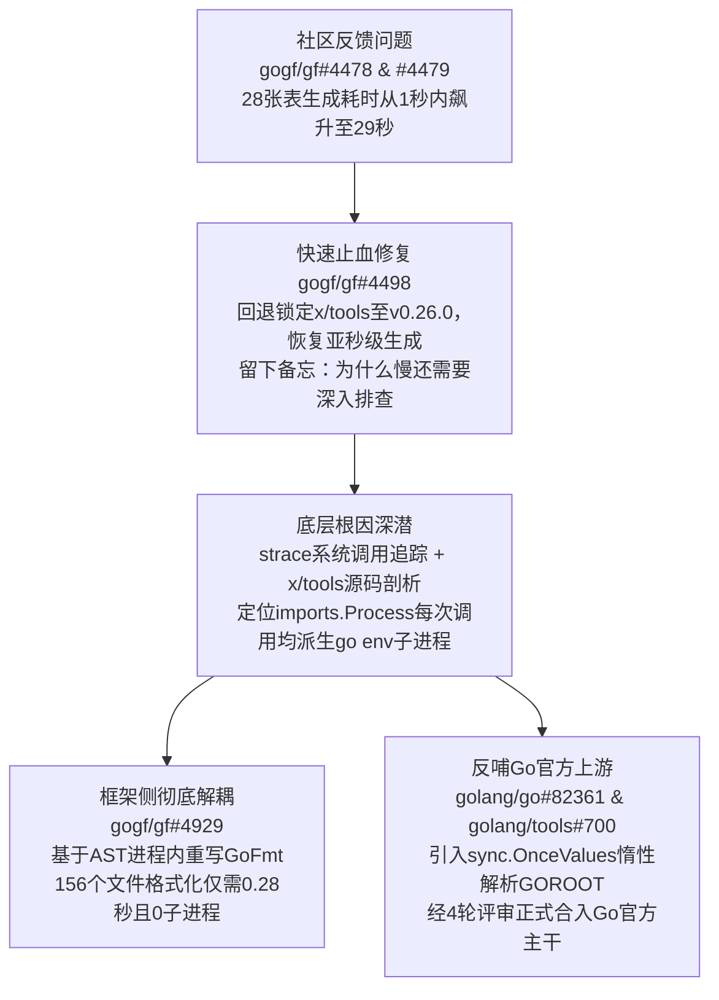
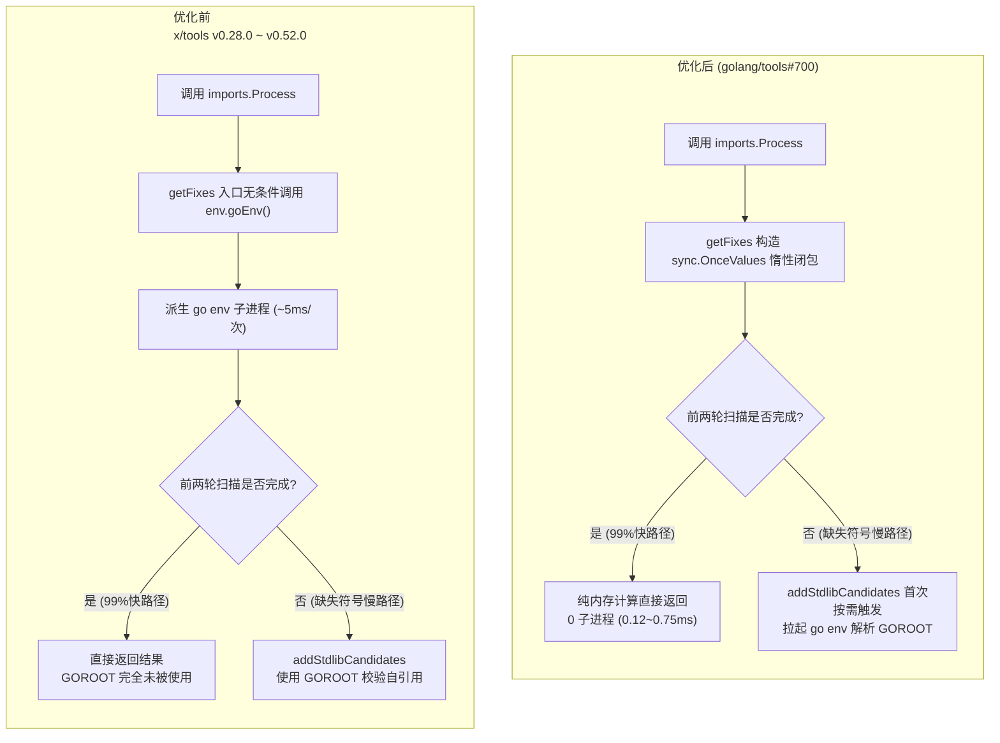

2026年11月26日，随着`Go`官方代码审查平台`Gerrit`上的变更单`CL 851285`正式合入主干，`GoFrame`核心开发团队成员`hailaz`（社区昵称：码到功成）向`Golang`官方工具链仓库提交的`PR`——[golang/tools#700](https://github.com/golang/tools/pull/700)（关联官方议题[golang/go#82361](https://github.com/golang/go/issues/82361)），历经4个`Patch Set`的严格评审与`LUCI TryBot`全量验证，在`Go`官方核心维护者、`AWK`语言联合创始人`Peter Weinberger`与`Go`团队工程师`Dmitri Shuralyov`的共同批准（`Code-Review+2`）下顺利并入`golang.org/x/tools`官方仓库。

这是一个值得整个`GoFrame`社区共同祝贺的时刻。

不仅因为向`Go`官方核心仓库贡献代码本身有着极高的工程标准与审查门槛，更因为这个`PR`背后，藏着一段跨越一年、从`GoFrame`用户真实痛点出发、由表及里死磕根因、最终将优化成果反哺给全球`Go`开发者生态的完整工程故事。

## 一、缘起：一句“还需要深入排查”的工程承诺

故事的起点，要追溯到2025年10月社区里的一次日常反馈。

当时，社区开发者`@windvalley`在[gogf/gf#4478](https://github.com/gogf/gf/issues/4478)与[gogf/gf#4479](https://github.com/gogf/gf/pull/4479)中反映：在升级到`gf`命令行工具`v2.9.4`版本后，面对一个包含`28`张数据表的项目，原本在`v2.9.0`中不到`1`秒就能执行完成的`gf gen dao`和`gf gen service`代码生成命令，耗时突然飙升到了`20`至`29`秒。为了缓解这一卡顿，这位同学甚至热心地提交了一份引入表结构哈希缓存文件（`.gf_daogen_meta`）的增量生成方案。

面对这个提案，是直接合并新特性“绕过”慢的问题，还是先搞清楚为什么变慢？`hailaz`在评论区写下了这样一段话：

> “有没有具体一点的指标，慢是多慢，最好能定位一下根因。如果是好解决的问题，就不需要引入新的逻辑而提高理解和使用成本。”

这句朴素的回复，恰恰体现了`GoFrame`核心团队一贯的工程克制：**不轻易用增加系统复杂度的妥协方案去掩盖底层根因**。

随后，`hailaz`利用业务项目的真实表结构在本地展开复现与二分排查，很快锁定了性能退化来自底层依赖库`golang.org/x/tools`的跨版本升级。为了让广大开发者第一时间恢复流畅的开发体验，他在2025年10月28日迅速提交了修复[gogf/gf#4498](https://github.com/gogf/gf/pull/4498)，通过将`golang.org/x/tools`版本回退锁定至`v0.26.0`，随`v2.9.5`版本发布，让`gf gen dao`重新回到了亚秒级响应。

但在`gogf/gf#4498`的描述末尾，`hailaz`给自己留下了一句诚实的备忘：

> “至于为什么这两个库会导致慢，还需要深入排查。”

在很多日常开发场景里，“问题已解决、用户已恢复”往往意味着任务的结束。但对`hailaz`而言，锁定旧版本依赖只是一道临时的防火墙——只要上游根因一天没查清，每一次依赖升级都可能让性能退化卷土重来。这句写给自己的追问，最终在一年后结出了更深远的果实。



## 二、深潜：一行无条件执行的go env，拖慢了多少代码生成器？

为了彻底解开`golang.org/x/tools`变慢的谜团，`hailaz`深入剖析了`x/tools`从`v0.26.0`到高版本的演进历史，并借助`Linux`系统调用追踪工具`strace`对代码格式化过程进行了逐帧观测。

在`Go`生态中，`golang.org/x/tools/imports`（即大家熟知的`goimports`核心实现库）几乎是所有代码生成工具的标准基础设施。无论是`GoFrame`的`gf gen dao`、`gf gen service`、`gf gen pb`，还是社区中各类`ORM`、`RPC`与脚手架工具，在生成`.go`源文件后，通常会逐文件调用`imports.Process`来自动清理未使用的`import`并完成标准格式化。

通过运行`strace -f -e trace=execve`追踪一个导入语句原本就已经完整、无需任何增删修复的简单源文件，`hailaz`捕捉到了令人生畏的一幕：

```text
$ strace -f -e trace=execve ./bench input.go 2>&1 | grep execve
execve("/usr/local/go/bin/go", ["go", "env", "-json", "GO111MODULE", "GOFLAGS",
     "GOINSECURE", "GOMOD", "GOMODCACHE", "GONOPROXY", "GONOSUMDB", "GOPATH",
     "GOPROXY", "GOROOT", "GOSUMDB", "GOWORK"], ...) = 0
```

**每一次调用`imports.Process`，底层都会无条件派生（`fork + execve`）一个外部的`go env -json`操作系统子进程**！

顺着调用栈深入`internal/imports/fix.go`源码，真相水落石出：

1. **重构引入的隐性退化**：自`golang.org/x/tools`的`v0.28.0`版本进行`Source`接口重构起，`getFixes`函数在入口处无条件调用了`env.goEnv()`来获取`GOROOT`字符串，并将其传入`getFixesWithSource`。
2. **公开`API`无法复用缓存**：对于`gopls`这类常驻内存的语言服务器而言，它会长期复用同一个`ProcessEnv`实例，因此只会执行一次`go env`，开发团队在日常`IDE`体验中很难察觉异常；然而公开库函数`imports.Process`每次被调用时都会新建一个空的`ProcessEnv{Env: nil}`，导致所有将该包作为库调用的代码生成器，每格式化一个文件就要重新启动一次`go`二进制子进程。
3. **快路径上的无用功**：最关键的发现是，`hailaz`通读整条调用链后确认——`getFixes`费尽周折拿到的`GOROOT`，在整个流程中**唯一的消费者**是`addStdlibCandidates`函数里的一处标准库自引用防护判断（防止标准库包自导入）。而`addStdlibCandidates`仅在前两轮快速扫描失败、确实缺失外部符号的 **慢路径（Slow Path）** 上才会执行！

换句话说，对于代码生成器产出的绝大多数源文件（`import`已经完整，或者仅仅需要删除未使用的冗余`import`），程序走完内存级的快路径（`Happy Path`）即可直接返回，**耗时拉起子进程查出来的`GOROOT`在整个生命周期里根本没有被读取过哪怕一次**。

在本地高速`SSD`的`Linux`环境下，单次`go env`子进程开销约为`3.6~4.9 ms`；而在`Windows`环境、网络文件系统或高负载`CI`容器中，单次进程创建开销往往高达数十毫秒。当一个中型项目拥有`100`张数据表时，执行一次`gf gen dao`大约会生成`500`个源文件（涵盖`dao`、`dao/internal`、`do`、`entity`等），这就意味着平白无故地串行或并发拉起了 **`500`次`go env`外部进程**，原本几百毫秒的内存级`AST`处理瞬间劣化为数秒乃至数十秒的系统调用风暴。

定位到这一根因后，`hailaz`做了一件体现工程师担当的事——**双向破局**：

一方面，他在`GoFrame`仓库提交了[gogf/gf#4929](https://github.com/gogf/gf/pull/4929)，基于标准库`go/parser`、`astutil`与`go/format`在进程内完整重写了`cmd/gf`的`GoFmt`实现，彻底摆脱了对外部子进程的依赖。实测在`156`个生成文件的项目中，格式化总耗时直接降至 **`0.28`秒**，`go env`子进程调用数降为 **`0`**。

另一方面，尽管`GoFrame`自身的问题已经完美解决，他没有止步于“自家门前雪”，而是整理出详尽的最小复现代码、`strace`证据链与基准测试数据，向`Go`官方提交了议题[golang/go#82361](https://github.com/golang/go/issues/82361)，并同步递交了修复方案[golang/tools#700](https://github.com/golang/tools/pull/700)。

## 三、破局：用sync.OnceValues打造零子进程快路径

给`Go`官方核心库提`PR`，最考验的不是写出复杂的代码，而是**用最克制、最地道、零破坏性的改动解决核心矛盾**。

在[golang/tools#700](https://github.com/golang/tools/pull/700)中，`hailaz`没有触碰任何导出的公开函数签名（确保`gopls`及所有外部调用方100%无缝兼容），而是精准地将内部`pass`结构体中的`goroot`字段，从立即求值的`string`改造为按需惰性求值的闭包`func() (string, error)`，并巧妙利用`Go`标准库的`sync.OnceValues`保证并发安全与单次执行：

```go
func getFixes(ctx context.Context, fset *token.FileSet, f *ast.File, filename string, env *ProcessEnv) ([]*ImportFix, error) {
	source, err := NewProcessEnvSource(env, filename, f.Name.Name)
	if err != nil {
		return nil, err
	}
	// GOROOT is only needed by addStdlibCandidates, which runs only after
	// the first two passes fail. Resolve it lazily so that files with
	// complete imports do not spawn a `go env` subprocess.
	getGoRoot := sync.OnceValues(func() (string, error) {
		goEnv, err := env.goEnv()
		if err != nil {
			return "", err
		}
		return goEnv["GOROOT"], nil
	})
	return getFixesWithSource(ctx, fset, f, filename, getGoRoot, env.logf, source)
}
```

这一改动让整个`imports.Process`的执行路径焕然一新：



与此同时，为了从机制上锁死“快路径绝不派生子进程”的不变量，`hailaz`编写了表驱动单元测试`TestFixImportsNoGoEnv`，覆盖了完整导入（`usedImport`）、删除未使用导入（`unusedImport`）、空白导入（`blankImport`）、`//go:embed`指令（`embed`）以及无导入文件（`noImports`）5类典型场景。测试并未采用脆弱的`Mock`，而是直接利用未初始化的`ProcessEnv`：一旦底层误调`goEnv`，`env.Env`字典就会被真实子进程填充，通过断言`len(env.Env) == 0`，即可严密证明全程没有任何`go env`子进程被触发。

优化前后的实测性能对比一目了然：

| 对比维度 | 优化前（`v0.28.0+`） | 优化后（`PR #700`） | 实际收益 |
| :--- | :--- | :--- | :--- |
| 单文件快路径耗时 | `3.6 ~ 4.9 ms` | `0.12 ~ 0.75 ms` | 提速约**6至30倍**，恢复`v0.26.0`内存级水准 |
| 快路径`go env`子进程 | 每次调用1个 | **0个** | 彻底消除快路径`fork/exec`系统调用开销 |
| 500文件代码生成场景 | 额外增加`2.5s+`（慢盘达十余秒） | 约`0.06 ~ 0.35s` | 大规模代码生成不再受制于进程创建瓶颈 |
| 慢路径符号补全行为 | 入口预查询`GOROOT` | `sync.OnceValues`按需查询 | 公开`API`与语义**100%向下兼容** |

这份逻辑严密、测试扎实的补丁赢得了`Go`官方维护者的高度认可。在`Gerrit`评审期间，面对`Peter Weinberger`针对边界细节提出的评审意见与跨平台`TryBot`测试要求，`hailaz`严谨细致地完成了4轮迭代打磨，最终顺利合入`golang/tools`主干。这意味着，不仅是`GoFrame`，**全球所有依赖`golang.org/x/tools/imports`的`Go`代码生成工具、脚手架与开发者，都将在后续版本中直接受益于这次优化**。

## 四、七年同行：从第79号PR到核心团队的中坚力量

如果把时间轴拉长就会发现，`hailaz`能够敏锐捕捉到底层工具链的性能退化并回馈给`Go`官方，绝非偶然，而是他在开源世界里长达七年半深耕与积累的自然沉淀。

翻开`GoFrame`的提交历史，`hailaz`与社区结缘的第一行代码定格在**2019年4月4日**——[gogf/gf#79](https://github.com/gogf/gf/pull/79)（修复`gtime`日期解析异常并更正函数注释）。仅仅两天后，他又提交了[gogf/gf#82](https://github.com/gogf/gf/pull/82)补充`gtime`单元测试。在2019年那个夏天，他几乎把业余时间都投入到了最枯燥却最关乎框架生命线的底层基础工作中：从`gtype`、`gchan`、`gpool`、`gtree`，到并发锁机制`gmlock`、`gmutex`、`grpool`、`gflock`，再到数据校验`gvalid`与数据库`gdb`批量写入优化，一块块夯实了早期`GoFrame`的质量基石。

2019年8月，在独立仓库`gogf/gf-cli`创建之初，`hailaz`提交了该仓库历史上的**第1号`PR`**——[gogf/gf-cli#1](https://github.com/gogf/gf-cli/pull/1)（`add gf run`），为无数`GoFrame`开发者带来了热编译运行命令`gf run`的雏形。

从2019年到2026年，七年多的时光里，技术浪潮几经更迭，`hailaz`始终是`GoFrame`核心团队中最沉稳、最可靠的守护者之一：

| 贡献领域 | 代表性工作与社区足迹 |
| :--- | :--- |
| 核心组件演进 | 深度参与`gconv`（时区保留与指针切片转换）、`gdb`（`OmitZero`、多字段排序、达梦与`GaussDB`等驱动适配）、`ghttp`、`gstr`、`gfile`、`gtime`、`gerror`等核心模块研发与修复 |
| `gf`命令行工具链 | 从早期的`gf run`开创者，到持续打磨`gf init`版本重试、`gf gen dao`自定义模板标签与数据库扩展、`gf dep`依赖分析及`GoFmt`进程内重构 |
| 工程基建与版本发布 | 主导完善多模块`CI/CD`矩阵（`Go 1.25`至`Go 1.27`适配、缓存命中率优化、分组覆盖率上报），引入`CodeQL`与`Scorecard`供应链安全扫描，持续承担`v2.9.x`与`v2.10.x`多个版本的发版重任 |
| 社区评审与文档生态 | 在`gogf`开源组织累计提交**220多个**`PR`，认真审阅社区开发者提交的**330多个**`PR`；长期维护`gf-site`中英文文档与版本发布说明，并持续整理同步`Go`语言历代版本发布指南 |

在`GoFrame`核心团队里，像`hailaz`这样的伙伴从不热衷于浮夸的宣传。大家习惯了下班后在`Issue`区安静地复现用户提过来的边界场景，习惯了在`PR`评审里逐行推敲一处错误处理或内存分配，习惯了为0.5秒的构建延迟去翻遍上游源码。

正是这份**对工程品质的敬畏、对底层原理的求索、对社区用户的真诚负责**，构成了`GoFrame`一步步成长为企业级`Go`开发框架的真正底气。

## 五、星火成炬：期待更多的你，一起参与GoFrame建设

回顾这次从`gogf/gf#4478`、`gogf/gf#4498`一路走到`golang/tools#700`的历程，最让人触动的，其实是一种生生不息的**开源正循环**：

一位认真使用框架的社区同学提出了真实的性能反馈，促使核心团队成员深入底层既优化了`GoFrame`自身，又顺手为`Golang`官方工具链补上了一块拼图；而上游工具链的完善，又反过来惠及了更广阔的开发者群体。

很多关注`GoFrame`的同学常会觉得：“参与开源框架建设是不是门槛很高，一定要写出惊天动地的架构才能提`PR`？”

其实并非如此。正如七年前`hailaz`也是从修正一行注释、补充一个`gtime`单元测试（`#79`、`#82`）开始走进`GoFrame`核心团队一样，每一个伟大的开源项目，都是由无数次微小而认真的贡献汇聚而成的。无论你处于哪个阶段，都可以通过适合自己的方式成为`GoFrame`的共建者：

- **每一次严谨的反馈都是贡献**：在日常业务开发中遇到疑似问题时，附带清晰的复现步骤或基准数据提交`Issue`（就像推动本次优化的`#4478`一样），本身就是在帮助框架进化。
- **从文档与单元测试起步**：完善中英文技术文档中的一处示例、为某个基础组件补充一组边界单元测试，是熟悉框架源码结构最扎实、最受欢迎的切入点。
- **参与插件生态与工具打磨**：在`contrib/`下的数据库驱动、注册中心、配置中心适配，或是`cmd/gf`开发工具链的体验优化中，有着丰富的实战课题等待大家探索。
- **参与技术讨论与`Code Review`**：在社区交流群与`GitHub`讨论区解答新同学的疑惑、参与特性方案碰撞，同样在为社区注入宝贵的温度与活力。

再次向我们优秀的团队伙伴`hailaz`致以最诚挚的祝贺与敬意！也衷心感谢每一位在生产环境中信任`GoFrame`、为`GoFrame`提过建议、写过代码、改过文档、点亮过`Star`的开发者朋友。

开源是一场没有终点的长跑。道阻且长，行则将至；感谢大家一路相伴，期待有更多热爱技术的同学加入到`GoFrame`项目的建设中来，让我们脚踏实地，一起加油努力！

**相关链接参考**：

- `Golang`官方工具链`PR`：[https://github.com/golang/tools/pull/700](https://github.com/golang/tools/pull/700)
- `Golang`官方关联`Issue`：[https://github.com/golang/go/issues/82361](https://github.com/golang/go/issues/82361)
- `GoFrame`关联修复`PR`（阶段一）：[https://github.com/gogf/gf/pull/4498](https://github.com/gogf/gf/pull/4498)
- `GoFrame`进程内格式化重构`PR`（阶段二）：[https://github.com/gogf/gf/pull/4929](https://github.com/gogf/gf/pull/4929)
- `GoFrame`开源主仓库：[https://github.com/gogf/gf](https://github.com/gogf/gf)
