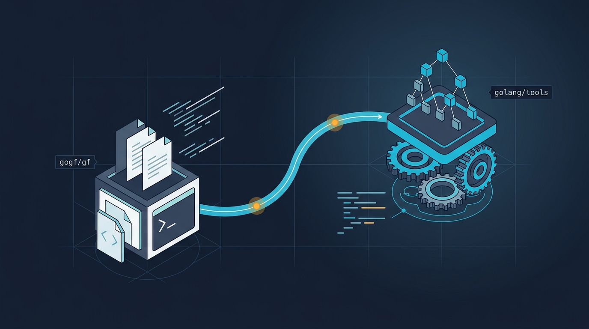
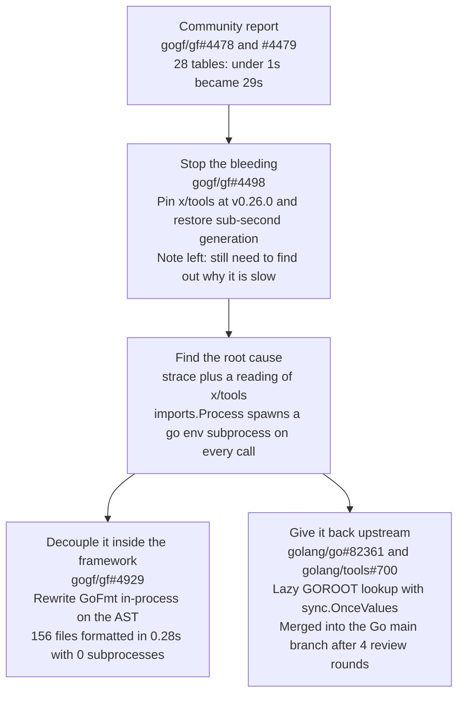
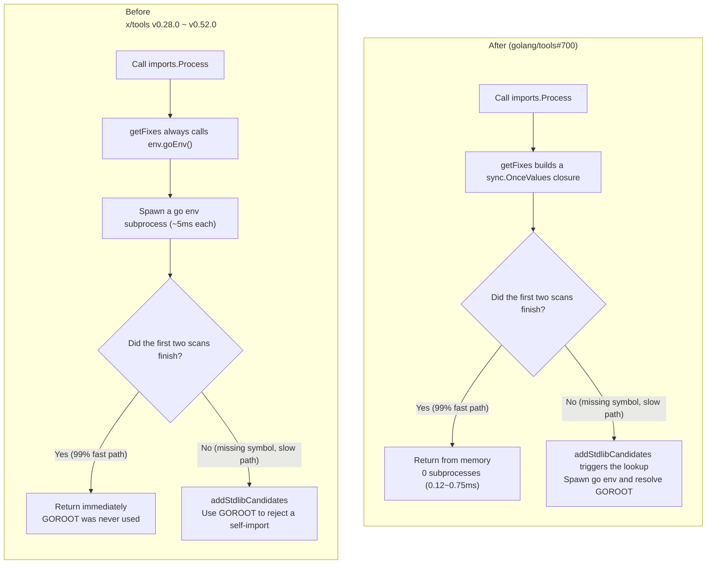

On November 26, 2026, change `CL 851285` was merged into the main branch on `Gerrit`, the official `Go` code review site. `hailaz` (community name: 码到功成), a core member of the `GoFrame` team, had submitted a `PR` to the official `Golang` toolchain repository — [golang/tools#700](https://github.com/golang/tools/pull/700) (related issue [golang/go#82361](https://github.com/golang/go/issues/82361)). After four `Patch Set` rounds of review and a full `LUCI TryBot` run, it was approved with `Code-Review+2` by `Peter Weinberger`, a core `Go` maintainer and co-creator of `AWK`, and `Dmitri Shuralyov`, an engineer on the `Go` team, and landed in `golang.org/x/tools`.

This is a moment the whole `GoFrame` community can celebrate.

Contributing to a core `Go` repository already means a high engineering bar and a strict review. Behind this `PR` is a longer story: more than a year that started from a real `GoFrame` user's pain, followed the cause all the way down, and ended by giving the improvement back to `Go` developers everywhere.

## 1. The Beginning: A Promise to Keep Investigating

The story starts with an ordinary community report in October 2025.

Developer `@windvalley` reported in [gogf/gf#4478](https://github.com/gogf/gf/issues/4478) and [gogf/gf#4479](https://github.com/gogf/gf/pull/4479) that, after upgrading the `gf` command-line tool to `v2.9.4`, a project with `28` tables saw `gf gen dao` and `gf gen service` jump from under `1` second on `v2.9.0` to `20`–`29` seconds. To ease the stall, they also submitted an incremental-generation proposal that cached table-structure hashes in `.gf_daogen_meta`.

Faced with that proposal, should the new feature be merged and the slowness worked around, or should the slowdown be explained first? `hailaz` wrote this in the comments:

> "Do we have a more concrete measurement of how slow it is? It would be best to pin down the root cause. If the problem is easy to fix, we should not add new logic that raises the cost of understanding and using the tool."

That plain reply is the restraint the `GoFrame` core team keeps: **do not hide a root cause behind a more complicated compromise**.

`hailaz` then reproduced the case locally with the real table structures from a business project and bisected the regression. The slowdown came from a version bump of `golang.org/x/tools`. To restore a smooth workflow quickly, on October 28, 2025 he submitted [gogf/gf#4498](https://github.com/gogf/gf/pull/4498), pinning `golang.org/x/tools` back to `v0.26.0`. Released with `v2.9.5`, `gf gen dao` returned to sub-second runs.

At the end of the `gogf/gf#4498` description, `hailaz` left himself an honest note:

> "As for why these two libraries make it slow, that still needs a deeper investigation."

In day-to-day work, "the problem is fixed and users are unblocked" often ends the task. For `hailaz`, pinning an old dependency was only a temporary firewall. Until the upstream cause was known, every future upgrade could bring the regression back. That question, written to himself, bore fruit a year later.



## 2. The Dive: One Unconditional go env, and How Many Generators It Slowed

To explain why `golang.org/x/tools` had become slow, `hailaz` read the history from `v0.26.0` through later releases and watched formatting with `strace`, the `Linux` system-call tracer.

In the `Go` ecosystem, `golang.org/x/tools/imports` — the library behind `goimports` — is standard infrastructure for code generators. After `GoFrame` commands such as `gf gen dao`, `gf gen service`, and `gf gen pb`, and after many community `ORM`, `RPC`, and scaffolding tools, each generated `.go` file is usually passed through `imports.Process` to drop unused imports and apply standard formatting.

Tracing a simple file whose imports were already complete, and needed no additions or removals, with `strace -f -e trace=execve` showed an unwelcome fact:

```text
$ strace -f -e trace=execve ./bench input.go 2>&1 | grep execve
execve("/usr/local/go/bin/go", ["go", "env", "-json", "GO111MODULE", "GOFLAGS",
     "GOINSECURE", "GOMOD", "GOMODCACHE", "GONOPROXY", "GONOSUMDB", "GOPATH",
     "GOPROXY", "GOROOT", "GOSUMDB", "GOWORK"], ...) = 0
```

**Every call to `imports.Process` unconditionally spawned (`fork + execve`) an external `go env -json` subprocess.**

Following the stack into `internal/imports/fix.go` made the cause clear:

1. **A regression hidden in a refactor.** Starting with the `Source` interface refactor in `golang.org/x/tools` `v0.28.0`, `getFixes` unconditionally called `env.goEnv()` at the entry point to obtain the `GOROOT` string and passed it into `getFixesWithSource`.
2. **The public `API` could not reuse the cache.** A long-running language server such as `gopls` keeps one `ProcessEnv` and therefore runs `go env` only once, so the cost is easy to miss in an `IDE`. The public function `imports.Process` creates a fresh empty `ProcessEnv{Env: nil}` on every call. Every generator that uses the package as a library starts a new `go` subprocess for every file it formats.
3. **Work thrown away on the fast path.** After reading the whole call chain, `hailaz` confirmed that the only consumer of that `GOROOT` is a standard-library self-import guard inside `addStdlibCandidates`. And `addStdlibCandidates` runs only on the **slow path**, after the first two quick scans fail because an external symbol is actually missing.

For the great majority of generated files — imports already complete, or only unused imports to delete — the in-memory fast path (`Happy Path`) returns directly. **The `GOROOT` fetched by starting a subprocess is never read even once.**

On a local `Linux` machine with a fast `SSD`, one `go env` subprocess costs about `3.6–4.9 ms`. On `Windows`, a network file system, or a busy `CI` container, process creation often costs tens of milliseconds. A medium project with `100` tables can emit about `500` source files from one `gf gen dao` run (`dao`, `dao/internal`, `do`, `entity`, and so on). That is **`500` extra `go env` processes**, serial or concurrent. In-memory `AST` work that should take a few hundred milliseconds becomes seconds, or tens of seconds, of system calls.

Once the cause was located, `hailaz` fixed it in both directions:

In the `GoFrame` repository he submitted [gogf/gf#4929](https://github.com/gogf/gf/pull/4929), rewriting `GoFmt` in `cmd/gf` entirely in-process with `go/parser`, `astutil`, and `go/format`, so it no longer depends on an external subprocess. On a project with `156` generated files, formatting dropped to **`0.28` seconds**, and the number of `go env` subprocesses dropped to **`0`**.

`GoFrame` itself was fixed, but he did not stop there. He prepared a minimal reproduction, the `strace` evidence, and benchmark numbers, filed [golang/go#82361](https://github.com/golang/go/issues/82361), and submitted the fix as [golang/tools#700](https://github.com/golang/tools/pull/700).

## 3. The Fix: A Zero-Subprocess Fast Path with sync.OnceValues

A `PR` to a core `Go` library is less about clever code than about **the smallest idiomatic change that fixes the real problem and breaks nothing**.

In [golang/tools#700](https://github.com/golang/tools/pull/700), `hailaz` did not change any exported function signature, so `gopls` and every external caller stay compatible. He changed the `goroot` field of the internal `pass` struct from an eagerly computed `string` into a lazy `func() (string, error)`, and used `sync.OnceValues` from the standard library so the lookup is concurrency-safe and runs at most once:

```go
func getFixes(ctx context.Context, fset *token.FileSet, f *ast.File, filename string, env *ProcessEnv) ([]*ImportFix, error) {
	source, err := NewProcessEnvSource(env, filename, f.Name.Name)
	if err != nil {
		return nil, err
	}
	// GOROOT is only needed by addStdlibCandidates, which runs only after
	// the first two passes fail. Resolve it lazily so that files with
	// complete imports do not spawn a `go env` subprocess.
	getGoRoot := sync.OnceValues(func() (string, error) {
		goEnv, err := env.goEnv()
		if err != nil {
			return "", err
		}
		return goEnv["GOROOT"], nil
	})
	return getFixesWithSource(ctx, fset, f, filename, getGoRoot, env.logf, source)
}
```

That change redraws the path through `imports.Process`:



To lock in the invariant that the fast path never spawns a subprocess, `hailaz` wrote the table-driven test `TestFixImportsNoGoEnv`. It covers five cases: a complete import (`usedImport`), deleting an unused import (`unusedImport`), a blank import (`blankImport`), a `//go:embed` directive (`embed`), and a file with no imports (`noImports`). The test does not use a fragile mock. It uses an uninitialized `ProcessEnv`: if `goEnv` runs, the real subprocess fills `env.Env`. Asserting `len(env.Env) == 0` proves that no `go env` subprocess ran.

The measured difference is easy to read:

| Comparison | Before (`v0.28.0+`) | After (`PR #700`) | Gain |
| :--- | :--- | :--- | :--- |
| Fast path, one file | `3.6 ~ 4.9 ms` | `0.12 ~ 0.75 ms` | About **6 to 30 times** faster, back to the in-memory level of `v0.26.0` |
| `go env` subprocesses on the fast path | 1 per call | **0** | The fast-path `fork/exec` cost is gone |
| Generating 500 files | `2.5s+` extra (more than ten seconds on a slow disk) | About `0.06 ~ 0.35s` | Large generation runs are no longer bound by process creation |
| Symbol completion on the slow path | `GOROOT` queried up front | Queried on demand with `sync.OnceValues` | Public `API` and behavior stay **fully compatible** |

The careful patch and its tests were well received by the `Go` maintainers. During `Gerrit` review, `hailaz` worked through `Peter Weinberger`'s comments on edge cases and the cross-platform `TryBot` requirements across four iterations, and the change was merged into `golang/tools`. Not only `GoFrame`, but **every `Go` code generator, scaffold, and developer that depends on `golang.org/x/tools/imports` will benefit in later releases**.

## 4. Seven Years Side by Side: From PR #79 to a Pillar of the Core Team

`hailaz` noticing a toolchain regression and sending the fix upstream was not an accident. It follows seven and a half years of work in open source.

His first line in `GoFrame` is dated **April 4, 2019**: [gogf/gf#79](https://github.com/gogf/gf/pull/79), fixing a `gtime` date-parsing bug and correcting a function comment. Two days later, [gogf/gf#82](https://github.com/gogf/gf/pull/82) added `gtime` unit tests. That summer he spent most of his spare time on the least glamorous and most necessary foundation work: `gtype`, `gchan`, `gpool`, and `gtree`; the locking pieces `gmlock`, `gmutex`, `grpool`, and `gflock`; then validation in `gvalid` and batch writes in `gdb`. Those pieces became part of the early quality base of `GoFrame`.

In August 2019, when the separate `gogf/gf-cli` repository was created, `hailaz` submitted its **first `PR`**, [gogf/gf-cli#1](https://github.com/gogf/gf-cli/pull/1) (`add gf run`). That was the start of the hot-reload command `gf run` that so many `GoFrame` developers use.

From 2019 to 2026, through several shifts in the technical landscape, `hailaz` has remained one of the steadiest people on the `GoFrame` core team:

| Area | Representative work |
| :--- | :--- |
| Core components | Deep work on `gconv` (preserving time zones and converting pointer slices), `gdb` (`OmitZero`, multi-field ordering, and drivers such as Dameng and `GaussDB`), `ghttp`, `gstr`, `gfile`, `gtime`, and `gerror` |
| The `gf` command-line tool | From the early `gf run`, to `gf init` version retries, custom template tags and database extensions for `gf gen dao`, `gf dep` dependency analysis, and the in-process `GoFmt` rewrite |
| Engineering and releases | The multi-module `CI/CD` matrix (`Go 1.25` through `Go 1.27`, better cache hits, grouped coverage reports), `CodeQL` and `Scorecard` supply-chain scans, and release work across `v2.9.x` and `v2.10.x` |
| Review and docs | More than **220** `PR`s submitted in the `gogf` organization, and more than **330** community `PR`s reviewed; long-term care of the Chinese and English `gf-site` docs and release notes, plus the `Go` release guides |

People like `hailaz` on the `GoFrame` core team do not chase loud announcements. The habit is to reproduce a user's edge case in an `Issue` after work, to read an error path or an allocation line by line in review, and to open upstream source for a `0.5` second build delay.

**Respect for engineering quality, curiosity about how things actually work, and responsibility to community users** are what let `GoFrame` grow into an enterprise `Go` framework.

## 5. From a Spark to a Flame: Come Build GoFrame with Us

Looking back from `gogf/gf#4478` and `gogf/gf#4498` to `golang/tools#700`, the lasting part is a healthy open-source loop:

A developer using the framework reported a real performance problem. A core member followed it into the foundation, improved `GoFrame`, and also filled a gap in the official `Golang` toolchain. The upstream fix then helps a much wider group of developers.

People watching `GoFrame` often ask whether contributing to an open-source framework requires a grand architecture before a `PR` is welcome.

It does not. Seven years ago `hailaz` also started by correcting one comment and adding one `gtime` unit test (`#79` and `#82`). Every large open-source project is a pile of small, careful contributions. Wherever you are, there is a way to help build `GoFrame`:

- **A careful report is a contribution.** When something looks wrong in daily work, an `Issue` with clear reproduction steps or benchmark numbers — as `#4478` did — helps the framework improve.
- **Start with docs and tests.** Fixing one example in the Chinese or English docs, or adding a boundary test for a basic component, is a solid and welcome way into the source.
- **Help with plugins and tools.** Database drivers, registries, and config centers under `contrib/`, and the experience of the `cmd/gf` toolchain, still have plenty of practical work.
- **Join the discussion and `Code Review`.** Answering a newcomer's question in the community chat or on `GitHub`, or talking through a design, adds warmth as well as code.

Congratulations and thanks again to our teammate `hailaz`. Thanks also to everyone who trusts `GoFrame` in production, and to everyone who has filed a suggestion, written code, edited docs, or starred the project.

Open source is a long run with no finish line. The road is long, and walking it is how we arrive. Thank you for coming this far. We hope more people who love the craft will join the building of `GoFrame`. One solid step at a time.

**Related links**:

- Official `Golang` toolchain `PR`: [https://github.com/golang/tools/pull/700](https://github.com/golang/tools/pull/700)
- Related official `Golang` issue: [https://github.com/golang/go/issues/82361](https://github.com/golang/go/issues/82361)
- `GoFrame` fix, stage one: [https://github.com/gogf/gf/pull/4498](https://github.com/gogf/gf/pull/4498)
- `GoFrame` in-process formatting rewrite, stage two: [https://github.com/gogf/gf/pull/4929](https://github.com/gogf/gf/pull/4929)
- `GoFrame` repository: [https://github.com/gogf/gf](https://github.com/gogf/gf)
